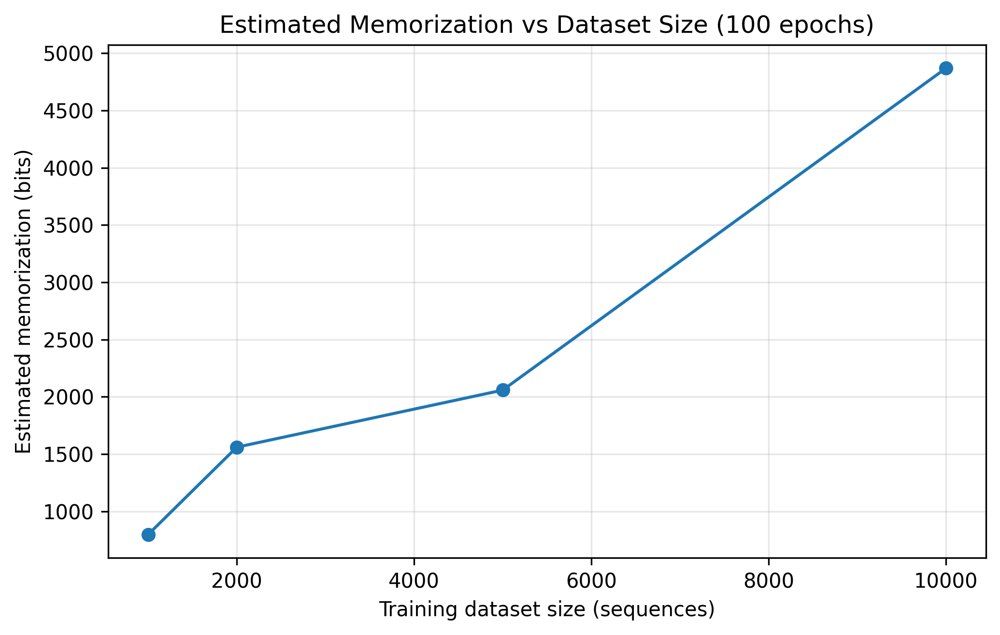
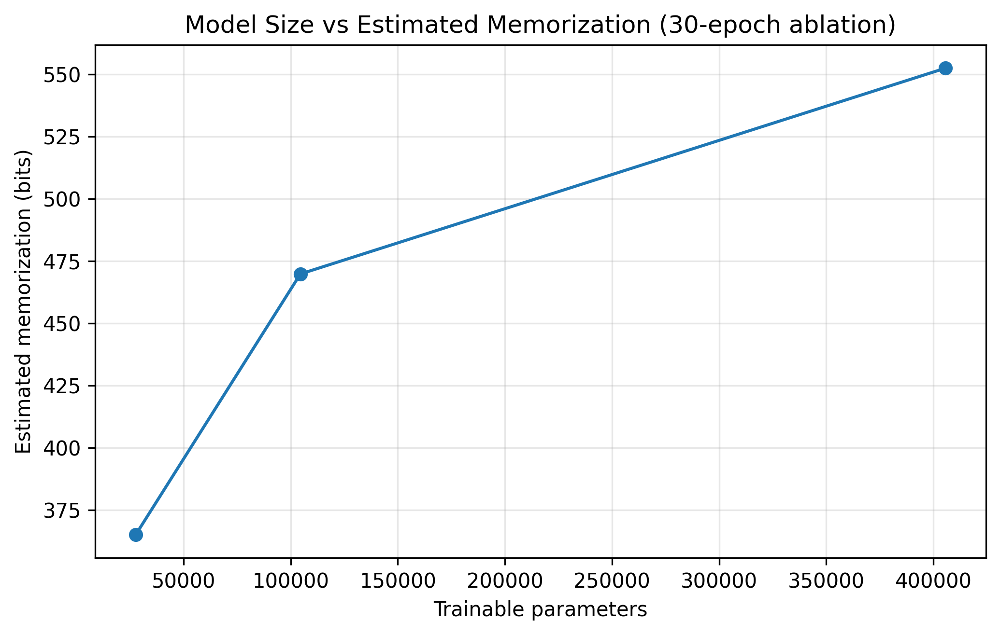
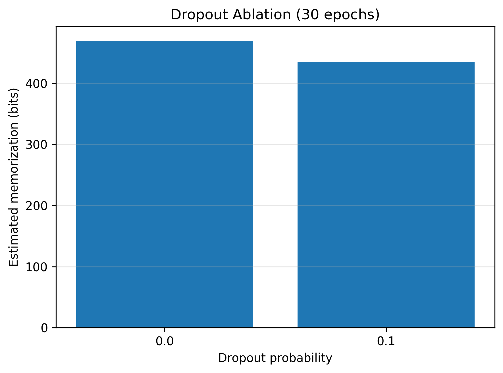
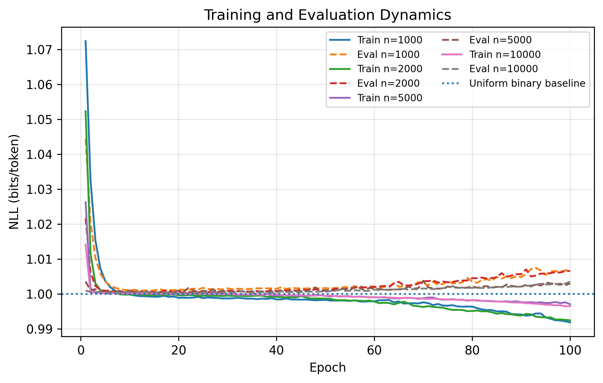

# Language Model Memorization: Reduced-Scale Reproduction

A reduced-scale PyTorch implementation investigating memorization in a small
causal Transformer trained on random binary sequences.

## Overview

This project studies how measured memorization changes with training dataset
size and model capacity. It also investigates the effects of dropout and
random initialization.

The experiments are a reduced-scale implementation inspired by the paper:

Morris et al., "How Much Do Language Models Memorize?",
ICML 2026, Proceedings of Machine Learning Research, Volume 306,
pp. 90392–90411.

## Research Questions

1. How does measured memorization vary with training dataset size?
2. How does model capacity affect total memorization and memorization per parameter?
3. Does dropout change the measured memorization?
4. How sensitive are the results to random initialization?

## Methodology

- Framework: PyTorch
- Architecture: Small causal Transformer
- Data: Random binary sequences
- Sequence length: 64
- Main model: 104,514 trainable parameters
- Main dataset sizes: 1,000, 2,000, 5,000, and 10,000 sequences
- Main training budget: 100 epochs per dataset size
- Evaluation dataset: 2,000 independently generated sequences
- Hardware: Google Colab Tesla T4 GPU

The model receives a beginning-of-sequence (BOS) token and predicts the
64 binary tokens autoregressively.

## Memorization Metric

For sequence i, let L_i be the negative log-likelihood in bits and let T=64
be the sequence length.

The measured memorization contribution is:

    M_i = max(0, T - L_i)

Total measured memorization is:

    M = sum_i M_i

Memorization per parameter is:

    M / P

where P is the number of trainable model parameters.

This is the operational metric used in this implementation; it should not be
interpreted as a universal measure of all forms of memorization.

## Main Results

| Training sequences | Parameters | Epochs | Train NLL (bits/token) | Eval NLL (bits/token) | Measured memorization (bits) |
|---:|---:|---:|---:|---:|---:|
| 1,000 | 104,514 | 100 | 0.991275 | 1.007238 | 797.04 |
| 2,000 | 104,514 | 100 | 0.991564 | 1.006584 | 1,559.70 |
| 5,000 | 104,514 | 100 | 0.997056 | 1.003021 | 2,058.11 |
| 10,000 | 104,514 | 100 | 0.995656 | 1.003504 | 4,868.55 |

## Ablation Studies

The project also includes:

- Model-size comparison: small, medium, and large Transformers
- Dropout comparison: 0.0 versus 0.1
- Random-seed robustness: seeds 123, 456, and 789

The detailed results and training histories are available in
`experiment_outputs_clean_submission/`.

## Figures

### Memorization versus dataset size

### Memorization versus model size

### Dropout ablation

### Training dynamics

## How to Run

1. Open `memorization_reproduction.ipynb` in Google Colab.
2. Select a GPU runtime if available.
3. Run the notebook cells from top to bottom.
4. The notebook generates experiment tables, histories, figures, and an output ZIP.

The full experiment can take several minutes depending on GPU availability.

## Limitations

- This is a reduced-scale experiment, not an exact reproduction of the original
  paper's model scale or reported results.
- The main experiments use 100 epochs. Training NLL continues to decrease
  in some runs, so full convergence is not established.
- Only a small number of random seeds are tested.
- Results depend on the architecture, dataset construction, optimizer,
  training budget, and operational definition of memorization.

## Repository Structure

    .
    ├── memorization_reproduction.ipynb
    ├── README.md
    ├── figures/
    └── experiment_outputs_clean_submission/
        ├── main_dataset_size_results.csv
        ├── main_training_history.csv
        ├── model_size_ablation.csv
        ├── model_size_training_history.csv
        ├── dropout_ablation.csv
        ├── dropout_training_history.csv
        ├── seed_robustness.csv
        ├── seed_training_history.csv
        └── experiment_config.json

## References

Morris, J. X., Sitawarin, C., Guo, C., Kokhlikyan, N., Suh, G. E.,
Rush, A. M., Chaudhuri, K., and Mahloujifar, S.
"How Much Do Language Models Memorize?"
Proceedings of Machine Learning Research, Volume 306, ICML 2026,
pp. 90392–90411.
